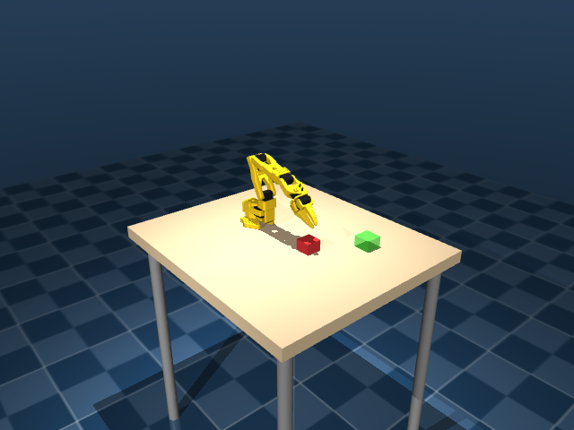
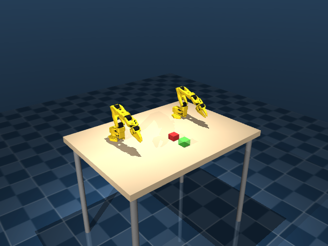

# SO-101 MNRI

MuJoCo simulation environments for the SO-101 robot arm (single-arm and
dual-arm), plus teleop and data-collection tooling. Conda env: `so101`.

```bash
conda activate so101
```

## Environments

| | Single arm | Dual arm |
|---|---|---|
| |  |  |
| Path | `envs/mujoco/so101_single_arm/` | `envs/mujoco/so101_dual_arm/` |
| Joints | 6 | 12 (2×6) |
| Cameras | 5 (wrist + 2 side + overhead + front) | 6 (2 wrist + 2 side + overhead + front) |

Four fixed-task envs built on the same robot/world pattern:

| | Path | Arms | Task |
|---|---|---|---|
| Pick-lift | `envs/mujoco/so101_single_arm_pick_lift/` | 1 | grasp cube, lift above threshold |
| Pick-and-place | `envs/mujoco/so101_single_arm_pick_place/` | 1 | grasp cube, place on target disc |
| Cylinder grasp | `envs/mujoco/so101_dual_arm_cylinder_grasp/` | 2 | grasp opposite ends of a free cylinder, lift together |
| Cylinder reach | `envs/mujoco/so101_dual_arm_cylinder_reach/` | 2 | reach target points above a static cylinder's ends |

Full details, camera lists, and observation/action spaces: **[ENVS.md](ENVS.md)**.

## Quick run

Look at an environment (interactive 3D view + live camera streams):

```bash
python scripts/verify_manual.py --env single
python scripts/verify_manual.py --env dual
```

Headless sanity check (CI-safe, exits nonzero on failure):

```bash
python scripts/verify_manual.py --env single --headless-check
python scripts/verify_manual.py --env pick_lift --headless-check   # and pick_place, cyl_grasp, cyl_reach
python verify_envs.py --env both
```

Tile every camera into one grid, save a PNG without opening a window:

```bash
python scripts/view_cameras.py --env single --save single_cams.png
```

Use in Python:

```python
from envs.mujoco.so101_single_arm.env import make_env, SingleArmEnvConfig

env = make_env(n_envs=1, cfg=SingleArmEnvConfig(task="push"))
obs, _ = env.reset()
obs, reward, terminated, truncated, info = env.step(action)
```

Set `MUJOCO_GL=egl` (or `osmesa`) for headless rendering on machines without
a display.

## Real-robot data collection (single arm)

Leader arm → follower arm + global/wrist cameras → `LeRobotDataset` (**v3.0**,
written by LeRobot's own `lerobot-record`), with a live view in Rerun (native
desktop viewer, or the browser UI over SSH).

```bash
bash scripts/record_so101.sh             # pose gate, then record
bash scripts/record_so101.sh --dry-run   # check config, no hardware
bash scripts/record_so101.sh --profile=12  # time the loop (separate *_profile dataset)
```

Current dataset: `thakk100/pink_duck_in_a_box` → `data/thakk100_pink_duck_in_a_box`
(100 × 20 s at 15 fps, 640×480). Hardware, dataset, task prompts and camera
roles live in `scripts/so101_env.sh`.

### Do not recalibrate the arms

> **Do not recalibrate the arms — the current calibration is verified, and
> recalibrating one arm silently breaks the recording path.**
>
> `robots/so101/calibration/mnri_arms_1_{leader,follower}.json` are the
> **verified** calibration for this rig, and they are what makes the leader and
> the follower agree. Recalibrating one arm silently breaks the recording path:
>
> - The two arms are compared **in degrees**, and those degrees come from these
>   two files. Re-calibrating one arm moves its zero point, so the arms stop
>   agreeing, and the pose gate (`MAX_POSE_DELTA`, default 10°) either blocks
>   every session or lets a 99° mismatch through.
> - `record_loop` calls `send_action()` on its **very first tick**. A mismatch
>   asks six servos to lunge against gravity: they stall, the rail sags, and the
>   Feetech bus starts dropping packets. That presents as a flaky cable, not as
>   a software bug.
> - A calibration is only as good as the sweep. Miss a joint, or sweep it
>   lazily, and the recorded range ends up **wider than the real travel**, so
>   the joint then reads pinned at ~1 % or ~99 % on every read. That is exactly
>   what the follower's `shoulder_lift` had: recorded over the full 0..4095 raw
>   span, when the joint really travels 756..3097.
> - `scripts/calibrate_arm.py` overwrites the file **and the arm's EEPROM**.
>   There is no undo except a backup directory.
>
> The current files were calibrated on 2026-09-25 and checked against the live
> arms. The previous ones are kept in
> `robots/so101/calibration/backup-20260925-215302/`.
>
> If a joint really is at a limit it should not be at, **read** it first and
> correct the range by hand — do not recalibrate:
>
> ```bash
> .venv/bin/python scripts/check_joint_range.py --arm leader --compare
> # raw counts at each physical end, then edit range_min / range_max
> ```
>
> `scripts/repair_calibration.py` writes the motor-side table back, serial-resolved.

### Using the arms

Both arms are 6-motor Feetech STS3215 buses and are identified by **USB
serial, never by `/dev/ttyACM*` order** — enumeration order reverses when you
replug them or change USB ports, and on 2026-09-25 that wrote the follower's
calibration into the leader's servos.

| | serial | rail |
|---|---|---|
| leader | `5AAF263743` | 5 V |
| follower | `5AAF263600` | 12 V |

The rails differ, so do not flag the leader as low-voltage against a 12 V
threshold.

**Before every session:**

```bash
bash scripts/record_so101.sh --dry-run                    # the argv LeRobot will get
.venv/bin/python scripts/check_record_config.py --deep     # really opens both cameras
.venv/bin/python scripts/check_pose_sync.py --watch        # live leader-vs-follower delta
```

Then:

1. Plug both arms in and power them. **One arm check at a time** — serial
   ports are exclusive, and a second open gives
   `SerialException: multiple access on port`, which looks like a dead bus.
2. `bash scripts/resolve_arm_ports.sh` — which port each serial is on today.
3. Bring the **leader** to the follower's pose **by hand**. The launcher runs
   the pose gate itself and refuses to start (exit 2) while any joint is more
   than `MAX_POSE_DELTA` (default 10°) off. Move the arm in your hand; never
   let the follower drive itself into position.
4. Start the live view in a second terminal (optional, but it is how you see
   what the camera actually sees):

   ```bash
   .venv/bin/python scripts/so101_debug_server.py
   # open http://localhost:9090/?url=rerun%2Bhttp%3A%2F%2Flocalhost%3A9876%2Fproxy
   # over SSH: ssh -L 9090:localhost:9090 -L 9876:localhost:9876 <this-host>
   ```

5. Record:

   ```bash
   bash scripts/record_so101.sh
   ```

Recording is **turn-based**: nothing is written until you say the scene is
ready. `SPACE` is the turn key — press it once the duck is placed, and again
after each reset. That is what stops a take from starting while your hand is
still in frame.

Keys (the **recording terminal** must have focus, not the Rerun window):

| key | during the episode | during the reset |
|---|---|---|
| `1`–`5` | pick the task prompt for the next episode | same |
| `i` `o` `k` `l` | duck start zone 1–4 for the next episode | same |
| `z` | clear the pending zone | same |
| `SPACE` | turn key — the scene is ready, start recording | end the wait, start recording |
| `s` / `f` | label success / failure **and end** the episode | (re)label, skip the rest of the reset |
| `d` | discard this take and re-record | discard the episode just recorded |
| `n` | end now, keep it unlabeled | skip the rest of the reset |
| `q` | stop — **wait for `Exiting`**; never Ctrl+C twice (corrupts the dataset) | same |

The prompt and the zone are chosen *before* the take and survive a `d`
re-record, because the duck is still in the same place. Labels go to
`meta/outcomes.json` (sidecar; the v3 schema is untouched):
`python scripts/episode_outcomes.py --root data/thakk100_pink_duck_in_a_box`.

Full guide: **[docs/SO101_COLLECT_HANDOFF.md](docs/SO101_COLLECT_HANDOFF.md)** ·
capture reference: **[docs/SO101_RECORD_SETUP.md](docs/SO101_RECORD_SETUP.md)**

## Teleoperation

```bash
python scripts/teleop_gamepad_ik.py --env single         # gamepad -> Cartesian IK
python scripts/teleop_leader_arm.py --env single          # real SO-101 leader arm -> sim
```

Details, control mappings, and the `--dry-run` flags for hardware-free
testing: **[scripts/README.md](scripts/README.md)**.

`teleop_gamepad_ik.py`'s `IKTeleop` class is the integration point for
upcoming [mujoco-ar-viewer](https://github.com/Improbable-AI/mujoco-ar-viewer)
AR-driven teleop/data collection — the IK/physics loop doesn't change, only
the source of `set_ee_target()` calls.

## Robot definitions

Meshes, MJCF kinematics, and URDFs are canonical under `robots/so101/`
(shared by both envs, not duplicated) — see `robots/so101/README.md`.

## Repo layout

```
envs/
  mujoco/
    so101_single_arm/              single-arm env (env.py, assets/scene.xml)
    so101_dual_arm/                dual-arm env
    so101_single_arm_pick_lift/    single-arm: grasp + lift cube
    so101_single_arm_pick_place/   single-arm: grasp cube, place on target
    so101_dual_arm_cylinder_grasp/ dual-arm: grasp + lift cylinder together
    so101_dual_arm_cylinder_reach/ dual-arm: reach cylinder-end targets
  isaac/                (planned) Isaac Lab port
robots/so101/            shared meshes, MJCF, URDF — single source of truth
scripts/                 teleop, camera viewer, manual verification
images/                  screenshots used in this README / ENVS.md
```

## Working with other agents

If you're an agent picking up follow-on work in this repo, start at
**[AGENT_TASKS.md](AGENT_TASKS.md)** — open tasks, validation steps, and
constraints (e.g. don't duplicate meshes outside `robots/so101/`).

## Contributing

See [CONTRIBUTING.md](CONTRIBUTING.md) and [CONTRIBUTORS.md](CONTRIBUTORS.md).

## License

[CC BY-NC 4.0](LICENSE): free to share and adapt with attribution, for
non-commercial use only.
